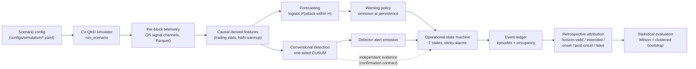

# Quantum Attack Detector

[](LICENSE)

**A research framework for causal attack monitoring, sequential detection, and early-warning evaluation in simulated CV-QKD systems.**

Quantum Attack Detector is an open research codebase that simulates a Gaussian-modulated coherent-state (GMCS) continuous-variable quantum-key-distribution link, injects physically modeled attack and benign-drift scenarios, and rigorously evaluates — with causal, emission-time-accurate event accounting — whether machine-learning forecasting or classical sequential detection provides useful advance warning of attacks.

> **Research software, not a product.** All results are generated in a synthetic simulator. Nothing here is hardware-validated, and nothing here should be deployed to protect a real QKD link. See [Scientific status](#scientific-status) and [Limitations](#limitations).

---

## Table of contents

- [Why this problem](#why-this-problem)
- [What the system distinguishes](#what-the-system-distinguishes)
- [Key capabilities](#key-capabilities)
- [Technology stack](#technology-stack)
- [Architecture](#architecture)
- [Repository structure](#repository-structure)
- [Supported research scenarios](#supported-research-scenarios)
- [Quick start](#quick-start)
- [Running simulations](#running-simulations)
- [Running evaluation](#running-evaluation)
- [Running tests](#running-tests)
- [Reproducibility](#reproducibility)
- [Scientific status](#scientific-status)
- [Limitations](#limitations)
- [Research integrity](#research-integrity)
- [Contributing](#contributing)
- [Security](#security)
- [License](#license)

---

## Why this problem

Continuous-variable QKD systems expose security-relevant telemetry — excess-noise estimates, transmittance, local-oscillator power, detector calibration, secret-key-rate estimates — at a high rate. An attacker who manipulates the local oscillator, biases detector calibration, taps and resends the signal, or jams the channel will perturb this telemetry in characteristic ways, and so will ordinary environmental drift.

The research question this repository is built to answer honestly is:

> *Does telemetry contain enough causal information to warn about an attack **before** it compromises key material — and how does that compare against a well-built classical sequential detector?*

The project's most important scientific finding is a negative one, and it is preserved deliberately: after correcting several measurement defects (look-ahead warning attribution, degenerate confidence intervals, ill-defined noise units), the evaluated forecasting operating point produced **no within-horizon forecasts at all** on unseen scenarios, while a simple calibrated CUSUM detector achieved a better false-alert/sensitivity trade-off. See [Scientific status](#scientific-status).

## What the system distinguishes

A central design requirement — enforced in code, not just documentation — is that these claims are never conflated:

| Concept | Meaning | Where implemented |
|---|---|---|
| **Threshold excursion** | A score first crosses its threshold | `baselines/warnings.py`, `baselines/conventional.py` |
| **Persistence satisfied** | The K-th consecutive qualifying observation arrives | same |
| **Alert emission** | The online system actually emits an alert — timestamped at persistence satisfaction, never backdated | `warnings.warning_events_for_scenario` |
| **Operational alert episode** | One continuous enter/exit of an alert state (sticky; repeated crossings do not fragment it) | `operational_states.alert_episodes_from_trace` |
| **Horizon-valid forecast** | An emitted alert whose lead satisfies `0 < onset − emission ≤ H` | `forecast_horizons.classify_warning_outcome` |
| **Extended pre-onset alert** | A real pre-onset alert emitted earlier than the forecast horizon (not a valid H-forecast) | same |
| **Active-attack confirmation** | Requires **independent evidence** (the calibrated sequential detector), never forecast probability alone | `operational_states.operational_state_series`, `baselines.conventional.confirmation_evidence_from_cusum` |
| **Retrospective attribution** | Offline scoring of already-emitted events using ground truth (never deletes an emitted alert) | `warnings.retrospective_sustained_retention` |

Online generation consumes only current/past telemetry and scores. Ground-truth onset metadata is structurally inaccessible to the online path — this is enforced by regression tests, including prefix-invariance tests that mutate the future and verify nothing in the shared past changes.

## Key capabilities

Verified implemented capabilities (each traceable to source and tests):

- **Physics-informed CV-QKD simulation** — GMCS protocol with heterodyne detection, fiber channel with Beer–Lambert loss, shot-noise/excess-noise bookkeeping, per-block parameter estimation (`simulator/`).
- **Five attack families** with per-family onset semantics — intercept–resend, LO manipulation, calibration manipulation, channel jamming (with/without probe phase), plus benign environmental drift and disturbance episodes (`simulator/attacks/`, `simulator/environment/`).
- **Causal feature engineering** — backward differences, trailing rolling statistics, EWMA, CUSUM, KS statistics, autocorrelation; NaN-until-warmup policy; leakage-tested invariance (`features.py`, `tests/test_data_integrity.py`).
- **Multi-horizon logistic forecasting** — per-horizon `P(attack within H)` with train-only scaler fitting and a pinned deterministic solver (`baselines/logistic.py`).
- **Causal sequential detection** — per-indicator one-sided CUSUM over per-scenario warmup-normalized residuals with Huber-capped deviates, persistence, cooldown, and documented missing-data reset (`baselines/conventional.py`).
- **Operational state machine** — seven states including `DEGRADED_TELEMETRY` and `ABSTAINING`, so missing telemetry is never silently reported as normal (`operational_states.py`).
- **Evidence-based attack confirmation** — `ACTIVE_ATTACK_CONFIRMED` requires sustained independent detector evidence; forecast probability alone can never confirm (`operational_states.py`, `baselines/conventional.py`).
- **Episode/occupancy accounting** — alert episodes and warning occupancy computed from actual state intervals, not marker spans or scenario counts (`operational_states.summarize_alert_burden`).
- **Statistical evaluation** — Wilson score intervals for event rates, scenario-clustered bootstrap for continuous metrics, non-degenerate intervals at 0 and 1 (`statistics.py`).
- **Telemetry robustness experiments** — perturbations in explicitly declared units (train-σ, feature-range, raw-absolute), correlated noise, impulses, quantization, dropout, dead channels (`noise_models.py`).
- **Reproducible experiment tooling** — deterministic generators, frozen pre-registered protocols, machine-readable event/scenario ledgers, hash-recorded confirmatory runs (`scripts/`, `configs/simulation/`).

## Technology stack

| Category | Technology | Notes |
|---|---|---|
| Core language | Python ≥ 3.11 | verified on 3.13.14 |
| Numerical computing | NumPy ≥ 1.26 | vectorized simulation and statistics |
| Data processing | pandas ≥ 2.2, PyArrow ≥ 15 | Parquet telemetry and manifests |
| Machine learning | scikit-learn ≥ 1.4 | logistic forecasting baselines |
| Optional ML benchmarks | PyTorch ≥ 2.2 | GRU/TCN comparators (lazy import; `pip install ".[ml]"`) |
| Statistics | SciPy ≥ 1.11 (dev only) | cross-checks of interval routines in tests |
| Configuration | PyYAML ≥ 6 | simulator batch configs |
| Testing | pytest ≥ 8 | 255 tests (see [Running tests](#running-tests)) |
| Experiment execution | CLI modules + scripts | `python -m quantumattack.simulator.generate`, evaluation runners |
| Version control | Git | full development history preserved |
| CI | GitHub Actions | dataset-independent test subset on Python 3.11/3.13 |

Minimum versions are the declared floors in `requirements.txt`; the whole set was installed and exercised from a clean virtual environment (numpy 2.5.4, pandas 3.0.6, scikit-learn 1.9.1, pyarrow 26.0.0, PyYAML 6.0.3, pytest 9.1.1). Transitive dependencies are intentionally not listed as core technologies.

## Architecture



*Solid arrows: online execution (causal only). Dashed arrow: the confirmation-evidence contract — forecast probability alone can never confirm an active attack.*

| Subsystem | Location | Responsibility |
|---|---|---|
| Simulator | `src/quantumattack/simulator/` | scenario configs, physics, attacks, telemetry export |
| Features | `src/quantumattack/features.py` | causal derived features with warmup policy |
| Forecasting | `src/quantumattack/baselines/logistic.py` | per-horizon logistic baselines |
| Sequential detection | `src/quantumattack/baselines/conventional.py` | CUSUM detector + calibration |
| Warning semantics | `src/quantumattack/baselines/warnings.py` | causal emission, event model, retrospective view |
| Operational states | `src/quantumattack/operational_states.py` | state machine, episodes, burden |
| Horizon attribution | `src/quantumattack/forecast_horizons.py` | mutually exclusive outcome taxonomy |
| Statistics | `src/quantumattack/statistics.py` | Wilson intervals, clustered bootstrap |
| Perturbations | `src/quantumattack/noise_models.py` | unit-explicit robustness experiments |
| Temporal units | `src/quantumattack/temporal_units.py` | single block↔second authority (1 block = 10 ms) |
| Evaluation runners | `scripts/` | reliability, benchmark, confirmatory runners |

## Repository structure

```text
Quantum-Attack-Detector/
├── .github/workflows/ci.yml   # dataset-independent test suite + CLI smoke test
├── configs/simulation/        # deterministic scenario batch definitions
├── docs/                      # protocols, research reports, audits
├── scripts/                   # evaluation runners and audit tooling
├── src/quantumattack/         # core package (simulator, baselines, evaluation)
├── tests/                     # 255 regression and acceptance tests
├── decisions.md               # sequential decision log (D-001…)
├── flow.md                    # verified system call flow
├── handoff.md                 # current verified state
├── pyproject.toml             # packaging + dependencies
├── requirements*.txt          # dependency manifests
├── LICENSE                    # Apache License 2.0
├── NOTICE                     # project attribution notice
└── SECURITY.md                # what counts as a defect in this project
```

Historical phase-named research documents under `docs/` (e.g. `phase5-final-report.md`) are preserved as scientific evidence and are referenced by the decision log.

## Supported research scenarios

All scenarios are **simulated**. Attack onset is defined per family as the first block in which the malicious mechanism modifies system state — never as "first abnormal telemetry".

| Scenario | Class | Simulated mechanism |
|---|---|---|
| Intercept–resend | sudden | beam-splitter tap plus resend with added excess noise; step change at onset |
| LO manipulation (fast/slow ramp) | gradual | local-oscillator attenuation ramping to an operating point, with excess-noise masking |
| Calibration manipulation (steep/slow) | gradual | biased detector gain/offset ramped to an operating point |
| Channel jamming (probe / sudden) | hybrid/sudden | background-light injection; optional low-power probe bursts during a precursor window |
| Benign channel drift | benign | OU fiber-loss wander, thermal LO coupling, calibration wander |
| Benign disturbances | benign | short high-magnitude background spikes, clock steps |

Class-A/B attacks model a preparation/precursor window before onset; class-C attacks are sudden by construction and correctly produce no pre-onset signal.

## Quick start

### Windows PowerShell

```powershell
git clone https://github.com/PrathamKapoor/Quantum-Attack-Detector.git
cd Quantum-Attack-Detector
python --version                      # requires >= 3.11
python -m venv .venv
.venv\Scripts\Activate.ps1
pip install -e .
pip install -r requirements-dev.txt
python -m pytest tests/ -q -ra --ignore=tests/test_phase4_dataset.py --ignore=tests/test_phase5_dataset.py --ignore=tests/test_data_integrity.py --ignore=tests/test_features.py --ignore=tests/test_temporal.py --deselect tests/test_confirmation_evidence.py::test_real_simulator_scenarios_end_to_end --deselect tests/test_conventional_detector.py::test_real_simulator_scenario_end_to_end --deselect tests/test_conventional_detector.py::test_attack_scenario_is_detected_end_to_end --deselect tests/test_conventional_detector_integrity.py::test_normalized_sigma_threshold_differs_from_absolute_quantile
```

The excluded tests require the historical research datasets, which are **not** in the repository (see [Reproducibility](#reproducibility)).

### Linux / macOS

```bash
git clone https://github.com/PrathamKapoor/Quantum-Attack-Detector.git
cd Quantum-Attack-Detector
python3 -m venv .venv && source .venv/bin/activate
pip install -e . && pip install -r requirements-dev.txt
python -m pytest tests/ -q -ra \
  --ignore=tests/test_phase4_dataset.py --ignore=tests/test_phase5_dataset.py \
  --ignore=tests/test_data_integrity.py --ignore=tests/test_features.py \
  --ignore=tests/test_temporal.py \
  --deselect tests/test_confirmation_evidence.py::test_real_simulator_scenarios_end_to_end \
  --deselect tests/test_conventional_detector.py::test_real_simulator_scenario_end_to_end \
  --deselect tests/test_conventional_detector.py::test_attack_scenario_is_detected_end_to_end \
  --deselect tests/test_conventional_detector_integrity.py::test_normalized_sigma_threshold_differs_from_absolute_quantile
```

No external credentials, API keys, databases, or environment variables are required — the simulator and evaluation are fully offline.

### Optional: GRU/TCN benchmark models

```bash
pip install ".[ml]"
```

## Running simulations

Generate the small Phase-1 example dataset (8 scenario definitions × 5 seeds, plus the matched counterfactual scenario generated for each paired attack — 65 Parquet files of 2,000 blocks each, about 15 s):

```powershell
python -m quantumattack.simulator.generate --config configs/simulation/phase1.yaml --out data/example
```

- `--config` — a YAML/JSON **batch specification** expanded by `simulator/generate.py::build_scenario_configs`. Top-level keys: `n_blocks` (default 2000), `horizons` (default `[10, 25, 50, 100]`), and a seed source — either `seeds` (simple expansion, Phase-1/2 style), `attack_seeds`/`benign_seeds` (Phase-3 style), partition pools `train_seeds`/`val_seeds`/`test_seeds`/`ood_seeds` (Phase-4 style) or per-scenario `seeds` (Phase-5 style). `shared.dataset_version` labels the batch. Each entry in `scenarios` has `name`, `class` (`normal`/`attack`), optional `attack: {attack_type, onset_block, ...}`, `pair`, `env` overrides and a `sample` map of `[lo, hi]` ranges sampled deterministically per scenario seed.
- `--out` — output directory; receives one Parquet file per scenario (35 signal channels plus metadata, labels and evaluation-only columns — 64 in total) plus `manifest.json` recording `block_ms = 10.0`, the schema version, the column classes and the batch configuration.
- Seeds are deterministic: the same config and seeds reproduce identical telemetry.
- Compute causal features:

```powershell
python -m quantumattack.features_cli --data data/example --out artifacts/example/features
```

## Running evaluation

Evaluation runners operate on generated datasets plus their derived feature directories. The research campaigns that produced the recorded results used the Phase-4 training corpus and the G1–G4 generalization partitions; those historical datasets are large and are not committed.

| Runner | Purpose |
|---|---|
| `scripts/evaluate_reliability.py` | corrected reliability evaluation: horizon-valid accounting, episode/occupancy burden, calibration, noise sensitivity; writes `reliability_report_v2.json` plus event/scenario ledgers |
| `scripts/evaluate_conventional_detector.py` | forecast-vs-conventional comparison at matched false-alert budgets |
| `scripts/evaluate_confirmatory.py` | executes the frozen confirmatory protocol on newly generated untouched seeds |
| `scripts/audit_normal_scenarios.py` | per-scenario false-alert reconciliation |

Example (requires locally generated datasets — see [Reproducibility](#reproducibility)):

```powershell
python scripts/evaluate_reliability.py
```

Outputs are written under `artifacts/` (git-ignored). Three evaluation tiers are distinguished throughout the documentation: **exploratory** experiments, **historical** evaluation (G1–G4, exposed during development), and the **frozen confirmatory** evaluation on untouched seeds. No final test set remains untouched after the recorded campaigns.

## Running tests

```powershell
python -m pytest tests/ -q -ra
```

- **255 tests** pass on the full local checkout (including the dataset-dependent integration tests).
- **Dataset-independent subset: 194 tests** — the CI command shown in [Quick start](#quick-start). No datasets required; this is the command the repository was validated with from a fresh clone.
- Tests that read the git-ignored `data/`/`artifacts/` directories are excluded from CI **by name** (5 modules plus 4 individual tests). They validate real simulator output end-to-end and require the regenerated datasets.

## Reproducibility

- **Time base:** one simulation block = 10 ms = 10⁶ symbols at 100 MBaud (`temporal_units.py` is the single conversion authority; regression-tested against the factor-of-ten error class).
- **Seeds:** every scenario is seeded; the generator and feature pipeline are deterministic. Re-running the same config reproduces datasets bit-for-bit.
- **Model:** logistic baseline uses `solver="liblinear"`; cross-process AUROC spread measured at ~5×10⁻⁶ over five independent processes (`tests/test_statistics.py`).
- **Protocols:** evaluation campaigns are pre-registered in `docs/` (`reliability-evaluation-protocol.md`, `confirmatory-evaluation-protocol.md`) with frozen seeds, metrics, and acceptance rules.
- **Regenerating historical datasets** (deterministic, ~30–60 min per phase):

  ```powershell
  python -m quantumattack.simulator.generate --config configs/simulation/phase3.yaml --out data/phase3
  python -m quantumattack.features_cli --data data/phase3 --out artifacts/phase3/features
  # repeat for phase4.yaml, phase5.yaml
  ```

  Manifests and the decision log record the original scenario counts for verification (Phase 3: 160 scenarios; Phase 4: 234; Phase 5: 160).
- **Numerical tolerance:** repeated runs are deterministic within process; cross-process metric agreement is ~5×10⁻⁶ AUROC (documented, not claimed as bitwise equality).

## Scientific status

**Gate: `WEAK SIGNAL`** — from the frozen pre-registered confirmatory evaluation on **148 genuinely untouched synthetic scenarios** (seeds disjoint from all 439 historical development seeds; protocol committed before generation; `docs/confirmatory-evaluation-protocol.md`, decision D-054).

| Metric (Wilson 95% CI) | Forecasting (frozen operating point) | Conventional CUSUM detector |
|---|---|---|
| Benign false-warning rate | **51.7% [39.3, 63.8]** | **6.7% [2.6, 15.9]** |
| Horizon-valid forecasts (H=100) | **0/88 (0.000)** | not applicable (detector) |
| Attack sensitivity (any alert) | 87/88 emitted an alert at all | 100% (88/88) |
| Pre-onset alerts | 87/88 scenarios emitted a pre-onset alert, median first-emission lead 887 blocks (8.87 s — outside the horizon) | 55.7% [45.3, 65.6] of attacks (49/88), median pre-onset lead 96 blocks (0.96 s) |
| Extreme-stress benign FPR | 43.3% [27.4, 60.8] | 10.0% [3.5, 25.6] |

Interpretation, stated plainly:

1. **The evaluated forecasting operating point is not operationally viable.** It produced zero within-horizon forecasts on unseen data at a ~52% benign false-alarm rate. Historical claims of 50–90% "warning success" were artifacts of look-ahead warning attribution and were withdrawn (decisions D-040, D-049, D-053).
2. **The classical sequential detector outperformed the forecaster at reachable false-alert budgets** on this evaluation population. No forecasting superiority is claimed anywhere in this repository.
3. **Detector alerts occur during modeled malicious preparation, not before any hostile action.** Across all 88 untouched attack scenarios, no detector alert preceded the first modeled adversarial mechanism (`precursor_start`). This is *early malicious-activity detection*, not prediction of an attack that has not begun.
4. **Attack confirmation is evidence-gated.** `ACTIVE_ATTACK_CONFIRMED` fired on 88/88 attacks and, honestly, on 4/60 benign scenarios — the confirmation state inherits the detector's false-alert rate.
5. Earlier robustness findings were also corrected: the reported "noise cliff" was an artifact of ill-defined noise units (graceful degradation in train-σ units), and degenerate `[1,1]`/`[0,0]` bootstrap intervals were replaced with Wilson intervals.

The complete evidence trail — including every invalidated metric — is in [`docs/reliability-research-report.md`](docs/reliability-research-report.md) and the decision log.

## Limitations

- **Synthetic-only validation.** The CV-QKD model is a closed-form Gaussian simulator anchored to published parameter-estimation cadence, but it has never been compared against hardware, published experimental traces, or an independent external simulator. Precursor observability is a modeling assumption.
- **No real-world calibration.** Probabilities are calibrated to the synthetic attack distribution only; they are not real-world attack probabilities.
- **Forecasting operating point is not viable** as configured (0/88 horizon-valid; ~52% benign FWR). Any future operating-point work must re-select on validation data with adopted calibration.
- **Warmup contamination** (measured by a synthetic probe on real telemetry): an attack already active during the detector's 200-block baseline window is masked for weak signatures (8–10σ shifts → 0 detections); the strongest family remains detectable.
- **Benign-envelope overlap** (Phase-5 exposed data): 45 of 100 attacks show no pre-onset detector statistic above the benign 95th percentile; pre-onset detection covers the ramp subset only.
- **Confirmation false-alert inheritance:** 4/60 benign scenarios reached `ACTIVE_ATTACK_CONFIRMED` via detector evidence.
- **Cross-horizon probability incoherence:** separately fitted per-horizon models violate monotonicity on ~32–38% of adjacent pairs.
- **Limited attack-family coverage:** five families in one protocol variant (GMCS heterodyne); no DV-QKD, no Trojan-horse, no wavelength attacks.
- **Extreme environmental stress** degrades both systems (detector 10% benign FPR; forecaster 43%).

## Research integrity

This project distinguishes, and asks reviewers to distinguish:

- **Simulator evidence** — every number here comes from the internal synthetic twin.
- **Algorithmic correctness** — enforced by 255 regression/acceptance tests covering causal emission timing, outcome exclusivity, leakage invariance, and interval validity.
- **Statistical evaluation** — scenario-level independence, Wilson intervals, clustered bootstrap.
- **Real-world security validation** — **none**. No quantum-communication security guarantee, attack prevention, or hardware performance is claimed or implied.

## Contributing

Contributions are welcome as ordinary pull requests. Please:

1. Run the test suite (CI subset locally, full suite if you have generated the datasets).
2. Preserve the causal-semantics invariants — in particular: no future information in online paths, emission ≠ excursion start, mutually exclusive outcome categories. `tests/test_causal_warning_semantics.py` and `tests/test_confirmation_evidence.py` encode these contracts.
3. Record meaningful engineering decisions in `decisions.md` (sequential `D-NNN`).
4. Keep new files organized by responsibility; no numbered development-phase folders.

## Security

This is research software for studying detection methodology in simulation; it does not connect to live systems and performs no network operations beyond package installation. Do not report simulated attack behaviour as a vulnerability — it is the subject of study. See [`SECURITY.md`](SECURITY.md) for what is in scope and how to report a genuine defect.

## License

Quantum Attack Detector is licensed under the
[Apache License, Version 2.0](LICENSE) (`Apache-2.0`).

You may use, modify, and distribute the licensed material
subject to the terms of the license, including its applicable
copyright, attribution, and notice requirements. Attribution for
the project itself is recorded in [`NOTICE`](NOTICE).

See the [LICENSE](LICENSE) file for the full legal terms.

> The license governs the code. It does **not** change the scientific status: this
> remains synthetic-only, research software that is not hardware-validated and not
> certified for protecting a live QKD link. See [Scientific status](#scientific-status)
> and [Limitations](#limitations).
